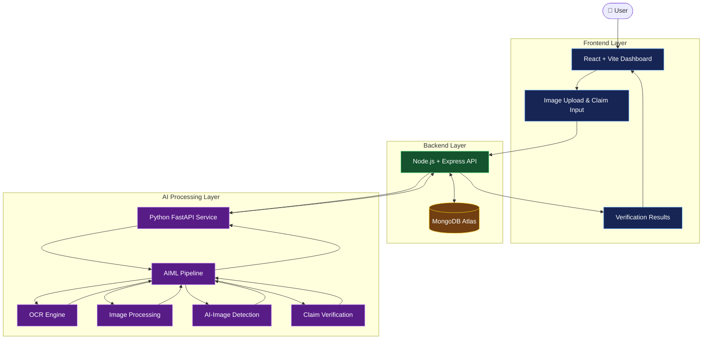
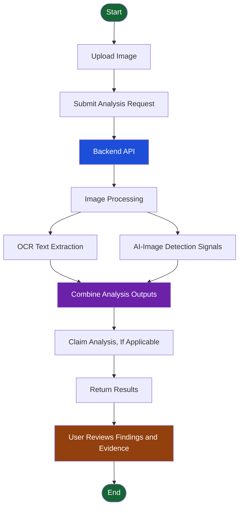

<div align="center">

# 🔎 ProofLens AI

### Verify Images. Verify Claims. See the Truth with Evidence.

**An AI-powered platform for image analysis, text extraction, and evidence-aware claim verification.**

<br/>


<br/>

**Built by Team AegisAI**

*Open Innovation — AI-Powered Image & Claim Verification*

</div>

---

## 🌐 Overview

**ProofLens AI** is an AI-assisted image and claim verification platform that helps users investigate suspicious visual content through image processing, Optical Character Recognition (OCR), AI-generated-image detection signals, and claim-focused evidence analysis.

Instead of relying on a single verdict, ProofLens AI brings multiple analysis signals into one workflow to help users understand the content and investigate the available evidence.

> 💡 **Our vision:** Make digital-content verification more accessible, transparent, and evidence-aware.

---

## 🚨 The Problem

In today's digital world, images and claims can circulate without sufficient context or reliable supporting evidence.

- 🖼️ **Uncertain image authenticity:** Users may struggle to assess whether an image could be AI-generated or manipulated.
- 🔤 **Hidden information:** Important text embedded in images can be difficult to extract and review.
- 🔍 **Unverified claims:** Statements may circulate without clear supporting evidence.
- ⚠️ **Fragmented investigation:** Users often need different tools to inspect images, extract text, and investigate claims.

## 💡 Our Solution

ProofLens AI combines these capabilities into a unified investigation workflow.

| Challenge | ProofLens AI Approach |
|---|---|
| Inspect an image | Image processing and AI-assisted analysis |
| Extract embedded text | OCR-based text extraction |
| Assess possible AI generation | Experimental AI-image detection signals |
| Investigate a claim | Evidence-aware claim analysis |
| Understand the outcome | Consolidated analysis results |

---

## ✨ Key Features

<table>
<tr>
<td width="50%" valign="top">

### 🖼️ Image Analysis

Process submitted images and generate analysis outputs to support further investigation.

</td>
<td width="50%" valign="top">

### 🔤 OCR Text Extraction

Extract text detected inside uploaded images for inspection and analysis.

</td>
</tr>
<tr>
<td width="50%" valign="top">

### 🤖 AI-Image Detection

Generate experimental signals that may help assess whether an image contains AI-generated content.

</td>
<td width="50%" valign="top">

### 🔎 Claim Verification

Analyze user-provided claims against available evidence and summarize the assessment.

</td>
</tr>
<tr>
<td width="50%" valign="top">

### 📊 Unified Dashboard

Access the image-analysis and verification workflow through a React-based interface.

</td>
<td width="50%" valign="top">

### 🧩 Modular Architecture

Separate the frontend, backend API, Python AI service, and analysis pipeline.

</td>
</tr>
</table>

---

## 🏗️ System Architecture

The application separates user interaction, API orchestration, AI processing, and data persistence into distinct layers.



### 🔄 Verification Workflow



*Note: The diagrams illustrate the intended high-level architecture and workflow. Exact execution order and optional processing steps depend on the implementation.*

---

## 🛠️ Technology Stack

| Layer | Technology | Purpose |
|---|---|---|
| Frontend | React + Vite | Interactive web interface |
| Styling | CSS | UI layout and visual design |
| Backend | Node.js + Express | API and request orchestration |
| AI Service | Python + FastAPI | AI-processing service interface |
| Image Processing | Python | Image analysis pipeline |
| OCR | OCR engine | Extract text from images |
| AI Analysis | Groq integration | AI-assisted analysis |
| Database | MongoDB Atlas | Application data persistence |

---

## 📂 Project Structure

```text
ProofLensAI/
│
├── AIML/
│   ├── ai_detector.py
│   ├── claim_verifier.py
│   ├── groq_analyzer.py
│   ├── image_processing.py
│   ├── ocr_engine.py
│   └── pipeline.py
│
├── Backend/
│   └── Express API and backend modules
│
├── Frontend/
│   └── React + Vite application
│
├── ai-service/
│   └── FastAPI AI service
│
├── .gitignore
└── README.md
```

*The tree highlights selected source files. Individual folders may contain additional modules, configuration files, tests, and assets.*

---

## 🚀 Getting Started

### Prerequisites

Make sure you have the following installed:

- [Node.js](https://nodejs.org/)
- [Python](https://www.python.org/)
- [Git](https://git-scm.com/)
- MongoDB Atlas access or a compatible MongoDB deployment
- Credentials for the AI integrations enabled in your environment

### 1. Clone the repository

```bash
git clone https://github.com/rajatsahani272-bot/ProofLensAI.git
cd ProofLensAI
```

### 2. Configure environment variables

Create local `.env` files in the relevant directories according to the variables expected by each service.

Configuration may include:

- MongoDB connection URI
- AI provider API key
- Backend port
- AI service URL
- Frontend API base URL
- Allowed frontend origin for CORS

**Security:** Never commit real API keys, database credentials, or `.env` files.

### 3. Install frontend dependencies

```bash
cd Frontend
npm install
```

Start the frontend using the script configured in `Frontend/package.json`.

### 4. Install backend dependencies

Open another terminal:

```bash
cd Backend
npm install
```

Configure the environment and start the backend using the script configured in `Backend/package.json`.

### 5. Set up the Python services

Create and activate Python virtual environments as appropriate, then install the dependencies specified by the project.

Configure and run the AIML pipeline and FastAPI service using their actual entry points and dependency files.

### 6. Development endpoints

| Service | Development endpoint |
|---|---|
| Frontend | Vite-configured local URL |
| Backend API | `http://localhost:5000` |
| AI Service | `http://localhost:8001` |

These are the development endpoints used during project development. Confirm the current ports and startup commands in the configuration before running the application.

---

## 🔌 API Overview

The backend verification workflow has been tested using:

`POST /api/verification/analyze`

The request uses a multipart analysis payload. Refer to the current backend route and frontend service implementation for the exact required field names and supported request options.

---

## 🔐 Responsible AI & Limitations

ProofLens AI is an investigation aid, not an infallible fact-checking system.

- **Probabilistic detection:** An AI-image detection score does not establish authenticity or prove that an image was generated by AI.
- **OCR limitations:** Poor image quality, unusual fonts, and distortion can affect extracted text.
- **Evidence quality:** Claim assessments depend on the quality, relevance, and reliability of available sources.
- **Source reliability:** Third-party information should not automatically be treated as official confirmation.
- **Human review:** Users should inspect supporting evidence and consult authoritative sources before drawing consequential conclusions.

Our goal is to support informed investigation, not replace critical thinking.

---

## 🎯 Hackathon Details

<div align="center">

| Detail | Information |
|---|---|
| **Project** | ProofLens AI |
| **Team** | ReactDev |
| **Track** | Open Innovation |
| **Focus** | AI-Powered Image & Claim Verification |
| **Tagline** | Verify Images. Verify Claims. See the Truth with Evidence. |

</div>

---

## 🗺️ Future Scope

Potential improvements include:

- 📚 Stronger source ranking and evidence provenance
- 🧾 Clearer citations and traceability for claim assessments
- 🖼️ More robust image-forensics signals
- ⚡ Faster processing and better performance monitoring
- 🧪 Broader testing across image types and edge cases
- 📱 Improved accessibility and responsive design

These are potential enhancements, not claims that the features are already implemented.

---

## 🤝 Contributing

Contributions that improve reliability, usability, transparency, and maintainability are welcome.

1. Create a branch for your change.
2. Make a focused improvement.
3. Test the affected functionality.
4. Submit a pull request with a clear description.

Please keep credentials and generated secrets out of version control.

---

## 📄 License

No license has been specified yet. A license should be added before others are granted explicit permission to reuse, modify, or distribute this project.

---

<div align="center">

### 🔎 ProofLens AI

**Verify Images. Verify Claims. See the Truth with Evidence.**

*Built with purpose by Team AegisAI.*

</div>
